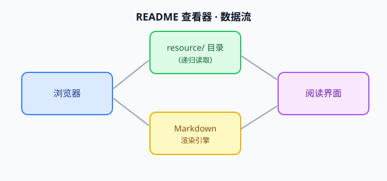

# 入门指南 · 总览

欢迎来到 **Resource 资源库**。本目录下（`resource/`）的所有子目录与文件会被 README 查看器**默认自动读取**，并按「主题 = 一级子目录」分组展示。

> 提示：左侧的「主题」对应 `resource/` 下的一级子目录；点开任意文件即可在右侧阅读或预览。

## 你将学到

- 如何浏览与检索资源
- 各主题目录分别是做什么的
- 遇到问题的排查入口

## 目录导航

| 主题 | 说明 |
| :--- | :--- |
| 入门指南 | 你正在看的这里 |
| 开发手册 | 前后端开发与配置 |
| 设计规范 | 色彩与样式令牌 |
| 运维手册 | 部署与日志 |

## 快速开始

1. 在左侧选择主题分组
2. 点击具体文件
3. 顶部搜索框可按「文件名 / 路径 / 正文」筛选

### 一个小例子

~~~bash
# 本地预览本资源库
python3 -m http.server 8000
# 然后浏览器打开 http://localhost:8000
~~~

## 待办清单

- [x] 默认自动读取 resource 目录
- [x] 按主题分组、可折叠
- [ ] 支持更多文件类型预览
