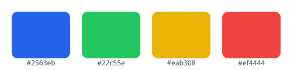

# 色彩系统

## 主色板

- 主色（Primary）：`#2563eb`
- 成功（Success）：`#22c55e`
- 警告（Warning）：`#eab308`
- 危险（Danger）：`#ef4444`

## 使用原则

1. 正文与背景对比度 ≥ 4.5:1
2. 主色只用于强调与可交互元素
3. 大面积背景使用中性色

> 样式令牌详见同级目录 `tokens.css`。
